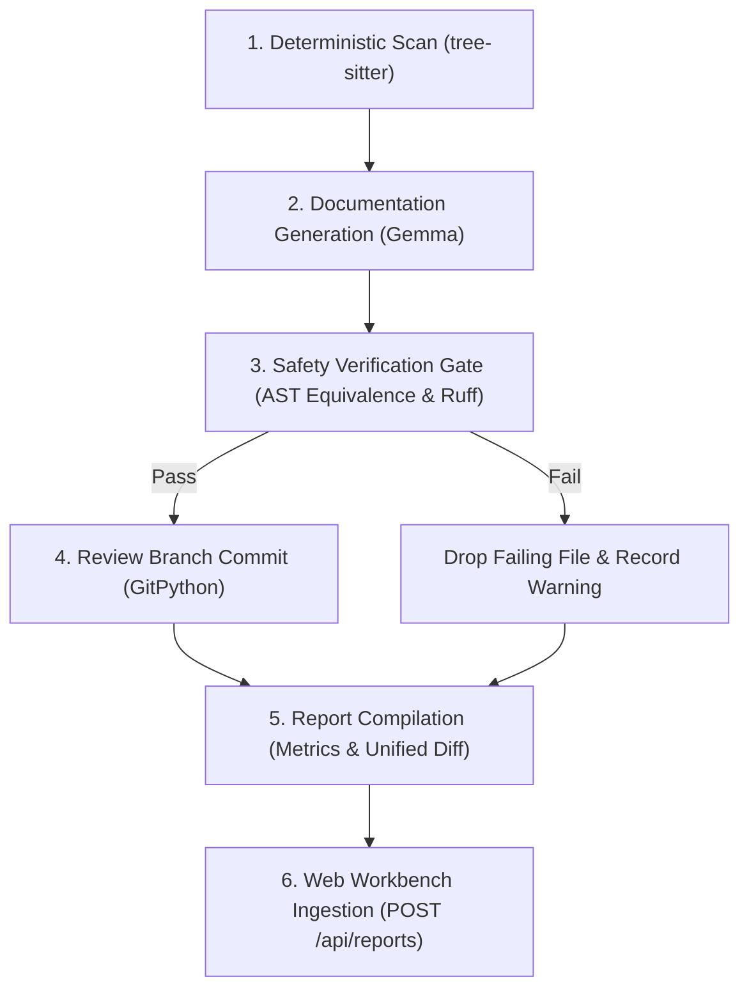

# CouchPilot

Autonomous repository housekeeping agent and review workbench that identifies missing docstrings and type annotations with deterministic static analysis, generates additions with open-weight Gemma models, and verifies safety via AST-equivalence gates.

CouchPilot automates maintenance on Python repositories without risking regressions:
- Scans codebases deterministically with tree-sitter to identify undocumented functions, classes, and missing type annotations.
- Generates Google-style docstrings and Python 3 type hints using open-weight Gemma models without altering executable code.
- Verifies changes against an AST-equivalence engine and Ruff lint gate, commits safe patches to isolated review branches, and publishes audit reports to a web workbench.

## Live Demo

- Live Workbench: [https://couchpilot-dashboard.onrender.com](https://couchpilot-dashboard.onrender.com)
- Demo Video: [https://youtu.be/-AYGjQud_X8](https://youtu.be/-AYGjQud_X8)

To evaluate CouchPilot with zero setup, navigate to the live workbench and click **Demo Run** in the header navigation; the dashboard operates in replay mode by default, executing a pre-recorded four-stage run against the bundled `sample_repo/` fixture without incurring LLM charges or requiring background workers.

## How It Works



1. **Deterministic Scan:** [app/core/scanner.py](app/core/scanner.py) parses Python files into tree-sitter syntax trees to extract missing docstrings, missing parameter annotations, and missing return annotations. Targets are identified strictly via static AST inspection; the LLM is never used to detect what needs fixing.
2. **Targeted Generation:** [app/core/llm_client.py](app/core/llm_client.py) batches target signatures into structured prompts for open-weight Gemma models. Gemma generates only docstrings and type annotations adhering to a strict Pydantic JSON schema; it is never prompted to rewrite or generate business logic.
3. **Safety Verification:** [app/core/validator.py](app/core/validator.py) parses original and patched source trees with Python stdlib `ast`, strips docstrings and type annotations from both, and asserts byte-for-byte AST dump equality. Touched files are then formatted with `ruff format` and linted with `ruff check --select E9,F`.
4. **Isolated Commit:** [app/core/git_ops.py](app/core/git_ops.py) stages verified files inside an isolated Git worktree and creates a commit on a review branch. Any file failing AST equivalence or Ruff checks is excluded from the commit.
5. **Report Compilation:** The run aggregates file diffs, token consumption, latencies, and validation statuses into a structured `Report` payload.
6. **Workbench Publication:** The completed report is sent via HTTP POST to the FastAPI review dashboard for maintainer inspection.

## Safety Guarantees

CouchPilot enforces six strict safety invariants in code before any code modification is committed:

| Safety Invariant | Implementation Mechanism | Enforcing Module |
| :--- | :--- | :--- |
| **Worktree Isolation** | Execution occurs in a dedicated temporary `git worktree` (`mkdtemp`), leaving the user working directory untouched. | [app/core/git_ops.py](app/core/git_ops.py) |
| **Protected Default Branch** | Commits and pushes to `main`, `master`, or active default branches are blocked with an exception. Review branches use `couchpilot/tidy-YYYYMMDD`. | [app/core/git_ops.py](app/core/git_ops.py) |
| **Docstring-Only AST Equivalence** | Stdlib `ast.NodeTransformer` strips docstrings and type annotations from original and patched trees. If `ast.dump()` differs, the patch is rejected. | [app/core/validator.py](app/core/validator.py) |
| **Ruff Syntax & Lint Gate** | Patched files must pass `ruff format` and `ruff check --select E9,F`. Failing files are dropped and flagged as lint failures. | [app/core/validator.py](app/core/validator.py) |
| **Untrusted LLM Output** | LLM responses are parsed through Pydantic JSON schemas. Patches are applied bottom-to-top by byte offset; body indentation is extracted from AST nodes. | [app/core/llm_client.py](app/core/llm_client.py), [app/core/patcher.py](app/core/patcher.py) |
| **Non-Destructive Dry Run** | `--dry-run` executes scanning, generation, and AST verification, outputting the diff without creating Git commits or pushing branches. | [cli.py](cli.py), [app/workflows/activities.py](app/workflows/activities.py) |

## Tech Stack

| Component | Technology | Role |
| :--- | :--- | :--- |
| **LLM Inference** | Gemma 2 (`gemma2-9b-it`, `gemma2:2b`) via OpenAI SDK | Generates Google-style docstrings and type annotations via structured JSON schema |
| **Static Analysis** | `tree-sitter` & `tree-sitter-python` | Deterministic AST scanning to extract targets missing documentation or annotations |
| **Code Verification** | Python `ast` & `ruff` | AST equivalence verification, automated code formatting, and syntax validation |
| **Version Control** | `GitPython` | Manages isolated worktrees, review branch generation, and unified diff extraction |
| **Orchestration** | Temporal (`temporalio` Python SDK) | Durable workflow execution, activity retries, heartbeats, and failure resilience |
| **Observability** | Sentry (`sentry-sdk`) | Distributed tracing, custom span hierarchies, and token/latency accounting |
| **Review Workbench** | FastAPI, Uvicorn, Jinja2, Pygments | Web dashboard displaying aggregate metrics, run history, and syntax-highlighted diffs |
| **Design System** | Tailwind CSS & Custom Design System | Calibrated workbench palette (`--oat`, `--slate`, `--plum`, `--marine`), WCAG AA compliant |
| **Cloud Deployment** | Render (`render.yaml` Blueprint) | Ephemeral web service deployment with auto-seeded SQLite database and health checks |

## Architecture

CouchPilot is decoupled into two independent operating halves:

1. **Review Dashboard (`app/web/`):** Runs on Render as an ephemeral web service using `requirements-web.txt`. It requires no Git, tree-sitter, or Temporal dependencies. Persistence is provided by an asynchronous SQLite database (`couchpilot.db`) seeded on startup from [fixtures/demo_reports.json](fixtures/demo_reports.json). It accepts reports via authenticated HTTP POST and hosts the one-click demo replay.
2. **Housekeeping Engine (`app/core/`, `app/workflows/`, `cli.py`):** Runs locally or in private CI environments using `requirements-worker.txt`. It executes tree-sitter scanning, calls Gemma endpoints, validates AST equivalence, manages Git worktrees, and coordinates workflows via a local Temporal worker.

```
week3/
├── app/
│   ├── core/
│   │   ├── git_ops.py       # Git worktree isolation and review branch protection
│   │   ├── llm_client.py    # OpenAI-compatible Gemma client with JSON validation and retries
│   │   ├── models.py        # Pydantic schemas for targets, patches, reports, and validation results
│   │   ├── patcher.py       # Bottom-to-top byte offset patch applicator with indentation detection
│   │   ├── scanner.py       # Deterministic tree-sitter AST scanner for functions and classes
│   │   ├── sentry_ops.py    # Sentry distributed tracing manager with silent fallback
│   │   └── validator.py     # AST-equivalence verification engine and Ruff lint gate
│   ├── web/
│   │   ├── config.py        # Web application configuration and startup security audits
│   │   ├── db.py            # SQLite async database layer with automatic fixture seeding
│   │   ├── main.py          # FastAPI application entrypoint with security headers and middleware
│   │   ├── pygments_style.py# Pygments syntax highlighting matching CouchPilot tokens
│   │   ├── routes/
│   │   │   ├── api.py       # REST API endpoints (/reports, /demo-trigger, /healthz)
│   │   │   └── views.py     # Jinja2 HTML views (overview dashboard, run history, run detail)
│   │   ├── static/          # CSS design tokens, JavaScript workbench interactions, and icons
│   │   └── templates/       # Jinja2 templates for workbench, metrics bar, and diff panels
│   └── workflows/
│       ├── activities.py    # Temporal activities for worktree, scanning, generation, and commits
│       ├── worker.py        # Temporal worker runner connecting to task queue
│       └── workflows.py     # CouchPilotWorkflow definition with durable retry policies
├── fixtures/
│   └── demo_reports.json    # Pre-recorded demo run fixtures for instant replay mode
├── sample_repo/
│   ├── calculator.py        # Messy arithmetic functions missing docstrings and annotations
│   ├── helpers.py           # String and datetime helper functions needing annotations
│   └── user_service.py      # User service class and methods missing documentation
├── tests/                   # Pytest test suite covering scanner, patcher, validator, and web API
├── cli.py                   # Click CLI interface (scan, tidy, worker)
├── render.yaml              # Render infrastructure-as-code deployment blueprint
├── requirements-web.txt     # Lightweight web dashboard dependencies
└── requirements-worker.txt  # Core engine and Temporal worker dependencies
```

## Quick Start (Local)

### Prerequisites

- Python 3.11+
- Git
- Temporal CLI (optional, required only for workflow orchestration)

### 1. Environment Setup

```bash
git clone https://github.com/Rish-51/CouchPilot.git
cd week3
python -m venv venv
```

Activate virtual environment:
- Windows: `.\venv\Scripts\activate`
- Linux/macOS: `source venv/bin/activate`

Install dependencies:

```bash
pip install -r requirements-worker.txt
pip install -r requirements-web.txt
```

### 2. Configuration

Copy the example environment configuration:

```bash
cp .env.example .env
```

Environment variables configured in `.env.example`:

| Variable | Description | Default / Example |
| :--- | :--- | :--- |
| `COUCHPILOT_MODE` | Service operating mode (`cli`, `worker`, `web`) | `cli` |
| `COUCHPILOT_DASHBOARD_URL` | URL of the review dashboard for report publication | `http://localhost:8000` |
| `COUCHPILOT_API_KEY` | Secret key for authenticated report ingestion | `couchpilot_secret_key_change_me_in_prod` |
| `DATABASE_URL` | SQLite database connection string | `sqlite+aiosqlite:///data/couchpilot.db` |
| `OPENAI_BASE_URL` | OpenAI-compatible endpoint URL | `https://api.groq.com/openai/v1` |
| `OPENAI_API_KEY` | API key for LLM provider | `your_groq_or_provider_api_key_here` |
| `LLM_MODEL_ID` | Primary Gemma model identifier | `gemma2-9b-it` |
| `LLM_FALLBACK_MODEL_ID` | Fallback Gemma model identifier | `gemma-2-9b-it` |
| `TEMPORAL_HOST` | Temporal server connection host | `localhost:7233` |
| `TEMPORAL_NAMESPACE` | Temporal namespace | `default` |
| `TEMPORAL_TASK_QUEUE` | Temporal task queue name | `couchpilot-task-queue` |
| `SENTRY_DSN` | Sentry DSN (optional; silent no-op when unset) | `""` |
| `DEMO_MODE` | Dashboard demo trigger behavior (`replay` or `live`) | `replay` |

#### Provider Presets

- **Groq (Cloud):** `OPENAI_BASE_URL=https://api.groq.com/openai/v1`, `LLM_MODEL_ID=gemma2-9b-it`
- **Google AI Studio (Cloud):** `OPENAI_BASE_URL=https://generativelanguage.googleapis.com/v1beta/openai/`, `LLM_MODEL_ID=gemma-2-9b-it`
- **Ollama (Local):** `OPENAI_BASE_URL=http://localhost:11434/v1`, `OPENAI_API_KEY=ollama`, `LLM_MODEL_ID=gemma2:2b`

### 3. Running Static Scan

Scan `sample_repo/` to view targets identified deterministically by tree-sitter:

```bash
python cli.py scan sample_repo
```

Real output from execution on `sample_repo/`:

```text
Scanning repository at: sample_repo

File: calculator.py (6 targets)
  [function] add -> missing: docstring, params(a, b), return_type
  [function] subtract -> missing: docstring, params(a, b), return_type
  [function] multiply -> missing: docstring, params(factor_one, factor_two), return_type
  [function] divide -> missing: docstring, params(dividend, divisor), return_type
  [function] quick_square -> missing: docstring, params(x), return_type
  [function] async_compute_sum -> missing: docstring, params(numbers), return_type

File: helpers.py (2 targets)
  [function] format_timestamp -> missing: docstring, params(epoch_seconds), return_type
  [function] sanitize_slug -> missing: docstring, params(input_text), return_type

File: user_service.py (7 targets)
  [class] UserService -> missing: docstring
  [method] UserService.__init__ -> missing: docstring, params(db_conn, cache_ttl)
  [method] UserService.get_user_by_id -> missing: docstring, params(user_id), return_type
  [method] UserService.update_user_status -> missing: docstring, params(user_id, is_active), return_type
  [method] UserService.session_count -> missing: docstring, return_type
  [class] AuthTokenValidator -> missing: docstring
  [method] AuthTokenValidator.validate_token -> missing: docstring, params(token_str, secret), return_type

Total files needing housekeeping: 3
Total targets identified: 15
```

### 4. Running Housekeeping via CLI

Execute a dry run to inspect AST validation without committing:

```bash
python cli.py tidy sample_repo --dry-run
```

Execute a real run that commits verified patches to an isolated review branch:

```bash
python cli.py tidy sample_repo
```

To push the created branch to remote origin, add the `--push` flag:

```bash
python cli.py tidy sample_repo --push
```

### 5. Running with Temporal Orchestration

Start the local Temporal development server:

```bash
temporal server start-dev
```

In a separate terminal, start the CouchPilot Temporal worker:

```bash
python cli.py worker
```

## CLI Reference

Commands and options implemented in [cli.py](cli.py):

- `python cli.py scan REPO_PATH`
  - Scans `REPO_PATH` recursively for Python functions and classes missing docstrings or type annotations using tree-sitter.
- `python cli.py tidy REPO_PATH [OPTIONS]`
  - Executes end-to-end housekeeping on `REPO_PATH` in an isolated Git worktree: scans targets, queries Gemma, validates AST equivalence, formats with Ruff, and commits clean changes.
  - `--dry-run`: Runs scanning, generation, and validation, then outputs the unified diff to stdout without committing to a branch.
  - `--push`: Pushes the newly committed review branch (`couchpilot/tidy-YYYYMMDD`) to remote `origin`.
- `python cli.py worker`
  - Connects to the configured Temporal server and polls `couchpilot-task-queue` to execute distributed housekeeping workflows.

## Dashboard and API

### Running the Dashboard Locally

Start the web dashboard server:

```bash
uvicorn app.web.main:app --host 0.0.0.0 --port 8000 --reload
```

The review workbench is accessible at `http://localhost:8000`.

### Real Endpoints

| Method | Path | Auth Required | Description |
| :--- | :--- | :--- | :--- |
| `GET` | `/` | None | HTML overview dashboard with aggregate metrics bar, recent runs feed, and active diff viewer |
| `GET` | `/runs` | None | HTML filterable run history feed (supports `?status=` and `?repo=` query parameters) |
| `GET` | `/runs/{run_id}` | None | HTML detail view for a specific run with Pygments syntax-highlighted diff |
| `GET` | `/healthz` | None | Service health check returning `{"status": "healthy", "service": "couchpilot-dashboard"}` |
| `GET` | `/api/reports` | None | JSON listing of reports with pagination (`limit`, `offset`) and status/repo filters |
| `GET` | `/api/reports/{run_id}` | None | JSON detail for a single run including file validation metrics and unified diff |
| `POST` | `/api/reports` | `X-CouchPilot-Key` | Ingests a completed run report into SQLite. Authentication enforced via constant-time token comparison |
| `POST` | `/api/demo-trigger` | None | One-click demo trigger for judges. In replay mode (default), retrieves `demo-run-001` from seeded fixtures |

### Security Middleware

Implemented in [app/web/security.py](app/web/security.py):
- **Defensive HTTP Headers:** Content Security Policy (`default-src 'self'`), Strict-Transport-Security (HSTS), X-Frame-Options (`SAMEORIGIN`), X-Content-Type-Options (`nosniff`).
- **Rate Limiting:** In-memory sliding-window limiter enforcing 20 req/min on `/api/demo-trigger` and 120 req/min on `/api/reports`.
- **Payload Size Capping:** Requests exceeding 5 MB (`MAX_BODY_SIZE`) are rejected with HTTP 413.

## Deploy to Render

The dashboard is configured for zero-configuration deployment via Render Blueprints using [render.yaml](render.yaml):

```yaml
services:
  - type: web
    name: couchpilot-dashboard
    runtime: python
    region: oregon
    plan: free
    buildCommand: pip install --upgrade pip && pip install -r requirements-web.txt
    startCommand: uvicorn app.web.main:app --host 0.0.0.0 --port $PORT
    healthCheckPath: /healthz
    envVars:
      - key: PYTHON_VERSION
        value: 3.11.9
      - key: COUCHPILOT_API_KEY
        generateValue: true
      - key: DEMO_MODE
        value: replay
      - key: DATABASE_PATH
        value: couchpilot.db
      - key: SENTRY_DSN
        sync: false
```

### Deployment Steps

1. Fork or push the repository to GitHub.
2. In the Render Dashboard, create a new Blueprint and select this repository.
3. Render automatically provisions the web service, generates a secure `COUCHPILOT_API_KEY`, and boots the service on Python 3.11.9.
4. On initial startup, [app/web/db.py](app/web/db.py) initializes the SQLite schema and seeds demo reports from [fixtures/demo_reports.json](fixtures/demo_reports.json).

### Connecting Local Engine to Render

To send reports from a local engine run to your deployed Render dashboard, update your local `.env`:

```env
COUCHPILOT_DASHBOARD_URL=https://<your-service-name>.onrender.com
COUCHPILOT_API_KEY=<generated-value-from-render-dashboard>
```

When workflows complete, `CouchPilotActivities.publish_report` attaches the `X-CouchPilot-Key` header and delivers the report to the remote dashboard.

## Observability

Distributed tracing is managed by [app/core/sentry_ops.py](app/core/sentry_ops.py). When `SENTRY_DSN` is empty or unconfigured, the manager falls back to no-op contexts without disrupting workflow execution.

### Span Hierarchy

```
couchpilot.run (Transaction: op="agent.run")
├── scan.repo (Span: op="scan.repo", tags={"engine": "tree-sitter"})
├── llm.generate (Span: op="llm.generate", tags={"model": model_id, "provider": base_url})
└── report.publish (Span: op="report.publish", tags={"dashboard_url": dashboard_url})
```

### Telemetry Recorded

- **Token Consumption:** Prompt tokens (`tokens_in`) and completion tokens (`tokens_out`) recorded on each generation span and aggregated into report metrics.
- **Latency Accounting:** Model round-trip execution latency (`latency_ms`) recorded on generation spans.
- **Verification Outcomes:** Per-file `ValidationResult` tracking `syntax_valid`, `ast_equivalent`, `ruff_check_passed`, `ruff_format_passed`, and error messages.
- **Trace Linking:** The active Sentry trace ID is stored on reports and rendered as a direct link to the Sentry Performance trace view in the web workbench.
- [TODO: Sentry Performance Trace Link](TODO: https://sentry.io/organizations/placeholder/performance/trace/placeholder/)

## Reliability

Workflow orchestration is implemented in [app/workflows/workflows.py](app/workflows/workflows.py) and [app/workflows/activities.py](app/workflows/activities.py).

### Activity Timeouts and Retries

| Activity | Timeout | Heartbeat | Retry Policy |
| :--- | :--- | :--- | :--- |
| `setup_worktree` | 2 minutes | None | Exponential backoff (max 4 attempts) |
| `scan_repo` | 1 minute | None | Exponential backoff (max 4 attempts) |
| `generate_batch` | 90 seconds | 20 seconds | Exponential backoff (max 4 attempts) |
| `validate_and_apply_patch` | 1 minute | None | Exponential backoff (max 4 attempts) |
| `commit_and_cleanup` | 1 minute | None | Non-retryable (`maximum_attempts=1`) |
| `publish_report` | 30 seconds | None | Exponential backoff (max 4 attempts) |

Standard retry policy configured across activities:
- `initial_interval`: 2 seconds
- `backoff_coefficient`: 2.0
- `maximum_interval`: 30 seconds
- `maximum_attempts`: 4

Non-retryable exceptions abort immediately without retry loops:
- `RepoNotFoundError`: Triggered when the target repository path does not exist on disk.
- `InvalidDashboardKeyError`: Triggered when dashboard authentication returns HTTP 401 or 403.

### Resilience to HTTP 429 and Laptop Sleep

- **Rate Limiting (HTTP 429):** When LLM providers return rate limit responses, the activity pauses and backs off exponentially up to 30 seconds across 4 attempts.
- **Laptop Sleep & Disconnection:** Temporal workflows persist execution state durably in the Temporal server. Activities report heartbeats every 20 seconds during LLM generation. If a laptop sleeps or loses network connectivity mid-run, execution resumes seamlessly from the last completed activity without repeating previously validated files.

## Testing

Run the test suite with pytest:

```bash
python -m pytest -v
```

Real execution results:

```text
============================= test session starts =============================
platform win32 -- Python 3.14.5, pytest-9.1.1, pluggy-1.7.0
rootdir: C:\Users\RISHIT\OneDrive\Microsoft Copilot Chat Files\Documents\GitHub\week3
plugins: anyio-4.15.1, asyncio-1.4.0, cov-7.1.0
collected 20 items

tests/test_llm_client.py::test_gemma_client_batch_success PASSED         [  5%]
tests/test_llm_client.py::test_gemma_client_retry_on_malformed_json PASSED [ 10%]
tests/test_patcher.py::test_bottom_to_top_patching PASSED                [ 15%]
tests/test_patcher.py::test_golden_diff PASSED                           [ 20%]
tests/test_scanner.py::test_scan_calculator PASSED                       [ 25%]
tests/test_scanner.py::test_scan_user_service PASSED                     [ 30%]
tests/test_scanner.py::test_scan_directory PASSED                        [ 35%]
tests/test_security.py::test_security_headers_present PASSED             [ 40%]
tests/test_security.py::test_constant_time_api_auth PASSED               [ 45%]
tests/test_security.py::test_input_validation_run_id_regex PASSED        [ 50%]
tests/test_security.py::test_payload_size_limit PASSED                   [ 55%]
tests/test_security.py::test_rate_limiter_enforcement PASSED             [ 60%]
tests/test_validator.py::test_ast_equivalence_accepts_docstrings_and_annotations PASSED [ 65%]
tests/test_validator.py::test_ast_equivalence_rejection PASSED           [ 70%]
tests/test_validator.py::test_validator_full_flow PASSED                 [ 75%]
tests/test_web_api.py::test_health_check PASSED                          [ 80%]
tests/test_web_api.py::test_api_reports_seeded PASSED                    [ 85%]
tests/test_web_api.py::test_api_reports_auth_required PASSED             [ 90%]
tests/test_web_api.py::test_demo_trigger PASSED                          [ 95%]
tests/test_web_api.py::test_html_views PASSED                            [100%]

============================= 20 passed in 2.77s ==============================
```

### Test Coverage

- **Tree-sitter Scanner (`test_scanner.py`):** Deterministic identification of classes, methods, async functions, unannotated parameters, and return types.
- **Patcher Engine (`test_patcher.py`):** Bottom-to-top byte offset replacements and golden unified diff generation.
- **Safety Validator (`test_validator.py`):** AST-equivalence acceptance of docstrings/types, rejection of altered logic statements, rejection of injected telemetry, and Ruff formatting gates.
- **LLM Client (`test_llm_client.py`):** Batch prompt generation, schema parsing, token accounting, and recovery from malformed JSON.
- **Security & Headers (`test_security.py`):** Defensive security headers, constant-time secret comparison, path regex sanitization, 5MB payload limits, and sliding-window rate limiting.
- **Web Dashboard API (`test_web_api.py`):** Health probes, fixture seeding, API report ingestion, demo triggers, and HTML template rendering.

## Known Limitations and Roadmap

- **Python-Specific Static Analysis:** Target detection and AST equivalence currently target Python via `tree_sitter_python` and standard library `ast`. Support for TypeScript and Go is planned.
- **Intra-File Type Resolution:** Type inference evaluates local function signatures and bodies. Complex cross-module type alias resolution via language servers or pyright is not yet integrated.
- **Single-Worker Concurrency:** Workflow generation currently processes files in bounded batches within a single worker instance rather than dynamically scaling activities across an auto-scaling worker cluster.
- **Git Repository Requirement:** The engine requires an initialized Git repository to create worktrees; non-git directories must be initialized with `git init` or evaluated with `--dry-run`.

## DEV Challenge Submission Notes

- **Google Gemma:** Open-weight Gemma models (`gemma2-9b-it`, `gemma2:2b`) are utilized strictly for docstring and type hint generation. Prompt engineering restricts responses to structured JSON adherence, ensuring the model never generates or mutates executable business logic.
- **Temporal:** Temporal manages the end-to-end housekeeping lifecycle as stateful workflows with heartbeats, bounded timeouts, and exponential retry policies. This architecture allows long-running repository sweeps to withstand network disconnects, laptop sleep, and API rate limits without corrupting state.
- **Sentry:** Sentry provides distributed tracing and performance metrics across both the local engine and the Render dashboard. Custom spans capture token counts, inference latencies, retry iterations, and Ruff validation outcomes, linking directly from the review workbench to Sentry trace views.

## License and Acknowledgements

Distributed under the MIT License. Built for the Hacktoberfest DEV Challenge.

Acknowledgements:
- Google DeepMind for open-weight Gemma models.
- Temporal Technologies for durable workflow orchestration.
- Sentry for distributed tracing instrumentation.
