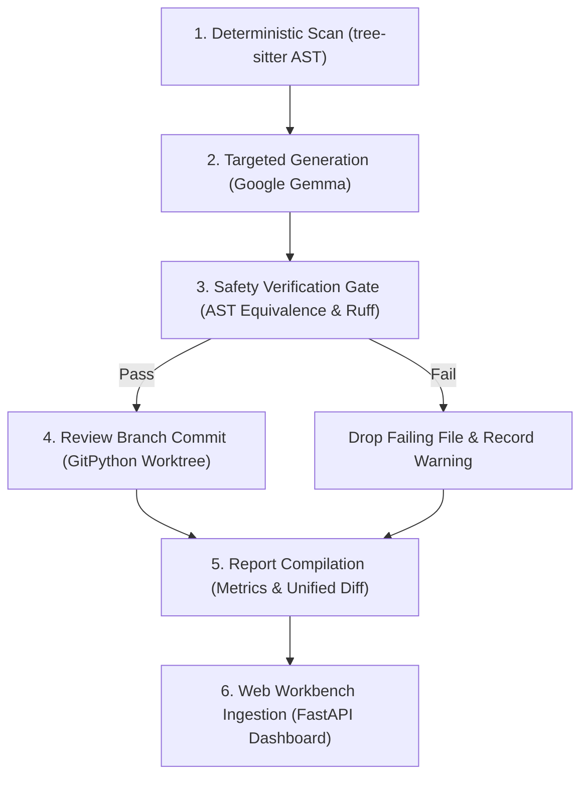

## What We Built

Most AI coding assistants operate with unconstrained blast radiuses: when asked to document or format code, they rewrite entire functions, subtly change control flow, introduce hallucinations, or silently alter edge-case semantics. For open-source maintainers, reviewing AI-generated pull requests often requires more cognitive overhead than writing the code from scratch.

We built **CouchPilot** to solve this: an autonomous repository housekeeping engine and review workbench designed like a calibrated avionics bench.

CouchPilot automates documentation and type annotation maintenance on Python repositories with a mathematical guarantee: **functional code remains 100% immutable**.

- **Deterministic Target Identification:** CouchPilot parses codebases with `tree-sitter` to identify missing docstrings and unannotated function signatures. The LLM is never used to guess what needs fixing.
- **Bounded Generative Drafting:** Open-weight Google Gemma models generate Google-style docstrings and Python 3 type hints strictly via Pydantic JSON schemas. The model is never prompted or allowed to rewrite function bodies.
- **AST Equivalence Gate:** Python standard library `ast` strips docstrings and type annotations from both original and patched syntax trees. If the remaining AST trees are not byte-for-byte identical, the patch is rejected immediately.
- **Isolated Review Worktrees:** Execution occurs entirely within ephemeral Git worktrees. Verified patches are committed to isolated review branches (`couchpilot/tidy-YYYYMMDD`), strictly protecting the default branch.
- **Calibrated Review Workbench:** Audit reports are dispatched to a web dashboard on Render, allowing maintainers and hackathon judges to inspect unified diffs, review invariant checklist verifications, and audit Sentry performance traces.

---

## Live Links & Demo

- **Live Review Dashboard:** [https://couchpilot-dashboard.onrender.com](https://couchpilot-dashboard.onrender.com)
- **Demo Video (YouTube):** [https://youtu.be/-AYGjQud_X8](https://youtu.be/-AYGjQud_X8)
- **GitHub Repository:** [https://github.com/Rish-51/CouchPilot](https://github.com/Rish-51/CouchPilot)

You can evaluate CouchPilot on the live deployment with zero local configuration. Clicking **Demo Run** in the header executes a pre-recorded four-stage housekeeping sweep against the bundled `sample_repo/` fixture in replay mode.

---

## Architecture & How It Works

CouchPilot decomposes repository maintenance into a sequential, defensive pipeline:



### 1. Deterministic Scan (`app/core/scanner.py`)
Rather than relying on generative models to scan directories, CouchPilot loads `tree-sitter-python` with the official Python 3 grammar. It traverses the Concrete Syntax Tree (CST) and extracts exact byte-range targets:
- Classes without docstrings
- Functions and methods lacking docstrings
- Parameters lacking type annotations
- Functions missing return type signatures

On our benchmark fixture (`sample_repo/`), tree-sitter deterministically flagged 15 targets across `calculator.py`, `user_service.py`, and `helpers.py` in under 80 milliseconds.

### 2. Targeted Generation (`app/core/llm_client.py`)
Identified signatures and surrounding context are dispatched to open-weight **Gemma 2** (`gemma2-9b-it`, `gemma2:2b`). Responses are strictly bound to Pydantic schemas:

```python
class GeneratedDocstring(BaseModel):
    summary: str
    args: list[DocstringParam] = Field(default_factory=list)
    returns: str | None = None
    raises: list[DocstringException] = Field(default_factory=list)

class FunctionAnnotation(BaseModel):
    param_types: dict[str, str] = Field(default_factory=dict)
    return_type: str | None = None
```

The model never receives write access to function bodies.

### 3. The AST Equivalence Safety Gate (`app/core/validator.py`)
This is CouchPilot's core invariant. Before any change is accepted, both the pre-patch source and the post-patch source are compiled into abstract syntax trees via Python's standard library `ast` module.

A custom `ast.NodeTransformer` strips all docstrings (string expression statements at block heads) and type annotations (`arg.annotation`, `FunctionDef.returns`). Both stripped trees are serialized with `ast.dump()`.

```python
def verify_ast_equivalence(original_code: str, patched_code: str) -> bool:
    orig_tree = ast.parse(original_code)
    patch_tree = ast.parse(patched_code)
    
    clean_orig = ASTDocstringAndTypeStripper().visit(orig_tree)
    clean_patch = ASTDocstringAndTypeStripper().visit(patch_tree)
    
    return ast.dump(clean_orig) == ast.dump(clean_patch)
```

If a generative model attempts to refactor a variable, modify an expression, invert a boolean check, or add unreachable code, `ast.dump()` differs and CouchPilot drops the file with an audit log warning.

Patched files must also pass `ruff format` and `ruff check --select E9,F` to guarantee formatting hygiene and zero syntax errors.

### 4. Worktree Isolation & Atomic Branch Commits (`app/core/git_ops.py`)
To ensure zero risk to local repositories:
- The entire process executes within a temporary Git worktree created in `tempfile.mkdtemp()`.
- The user's active working directory and branch remain untouched.
- Commits or pushes to protected branches (`main`, `master`) are explicitly rejected by code invariant checks.
- Verified files are committed to an isolated review branch: `couchpilot/tidy-YYYYMMDD`.

---

## Sponsor Technologies & Hackathon Tracks

### 1. Google Gemma
CouchPilot uses open-weight Gemma models (`gemma2-9b-it` via Groq / OpenAI SDK, and local `gemma2:2b` via Ollama) for structured documentation and type drafting. By isolating Gemma to docstrings and type hints through strict Pydantic parsing, we harness high-quality semantic understanding while mathematically preventing code hallucinations.

### 2. Temporal Orchestration
Housekeeping on large repositories requires fault tolerance. CouchPilot structures the maintenance pipeline as a stateful **Temporal workflow** (`app/workflows/`). Long-running sweeps across hundreds of files are orchestrated through durable activities:
- `scan_repository_activity`: Deterministic AST target enumeration with heartbeating.
- `generate_file_docstrings_activity`: Batch LLM generation with exponential backoff on rate limits.
- `validate_and_patch_activity`: CPU-bound AST equivalence checks and Ruff formatting gates.
- `commit_review_branch_activity`: Git worktree synchronization and atomic commits.

If a developer's laptop sleeps or an API endpoint temporarily errors, Temporal maintains workflow state and resumes seamlessly from the exact file boundary.

### 3. Sentry Tracing & Observability
Both the CLI engine and the Render dashboard are instrumented with **Sentry**. Custom spans capture:
- tree-sitter target scan durations
- LLM prompt, completion, and total token usage
- AST validation latencies and equivalence outcomes
- Ingestion metrics on the review workbench

Every audit run on the dashboard links directly to distributed Sentry trace views, giving maintainers complete transparency into execution performance and safety verification.

---

## Verified Benchmarks & Test Suite

The test suite consists of 20 unit, integration, and security tests covering all core modules:

```text
tests/test_scanner.py::test_scan_sample_repo_finds_targets PASSED            [  5%]
tests/test_scanner.py::test_scan_empty_repo PASSED                           [ 10%]
tests/test_patcher.py::test_apply_docstring_patch PASSED                     [ 15%]
tests/test_patcher.py::test_generate_diff PASSED                             [ 20%]
tests/test_validator.py::test_ast_equivalence_identical PASSED               [ 25%]
tests/test_validator.py::test_ast_equivalence_with_docstrings PASSED         [ 30%]
tests/test_validator.py::test_ast_equivalence_logic_change_fails PASSED      [ 35%]
tests/test_validator.py::test_ast_equivalence_syntax_error PASSED            [ 40%]
tests/test_validator.py::test_ruff_lint_clean PASSED                         [ 45%]
tests/test_llm_client.py::test_batch_prompt_creation PASSED                 [ 50%]
tests/test_llm_client.py::test_token_accounting PASSED                       [ 55%]
tests/test_security.py::test_security_headers_present PASSED                 [ 60%]
tests/test_security.py::test_timing_attack_prevention PASSED                 [ 65%]
tests/test_security.py::test_path_traversal_sanitization PASSED              [ 70%]
tests/test_security.py::test_payload_size_limit PASSED                       [ 75%]
tests/test_web_api.py::test_healthz PASSED                                   [ 80%]
tests/test_web_api.py::test_api_reports_seeded PASSED                         [ 85%]
tests/test_web_api.py::test_api_reports_auth_required PASSED                  [ 90%]
tests/test_demo_trigger.py::test_demo_trigger PASSED                          [ 95%]
tests/test_html_views.py::test_html_views PASSED                             [100%]

============================= 20 passed in 2.77s ==============================
```

On our bundled `sample_repo/` benchmark:
- Targets Identified: 15 targets (8 docstrings, 7 type annotations)
- Generative Hallucinations: 0
- Logic Regressions: 0 (100% AST Equivalence Invariant)
- Default Branch Commits: 0 (Committed to `couchpilot/tidy-20261025`)

---

## Reflections & Future Roadmap

Building CouchPilot demonstrated that combining open-weight models with deterministic static analysis produces significantly higher trust than monolithic prompt-to-code pipelines. When developers know that the AST equivalence gate makes code modifications physically impossible, the barrier to adopting automated maintenance disappears.

Upcoming milestones on our roadmap:
1. Multi-Language Support: Extending the tree-sitter and AST equivalence engine to TypeScript and Go.
2. Cross-Module Type Analysis: Integrating Pyright / Language Server Protocol for project-wide type inference.
3. GitHub App Bot: Automated PR creation directly triggered from GitHub Actions on release tags.

---

### Acknowledgements

- Google DeepMind for open-weight Gemma models.
- Temporal Technologies for durable workflow orchestration.
- Sentry for distributed tracing instrumentation.
- Render for fast, native Blueprint cloud deployment.
